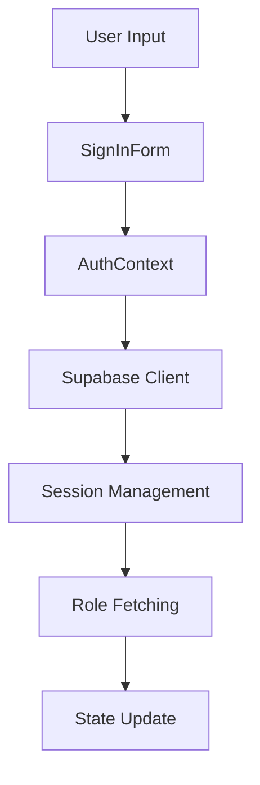

# Authentication Flow Analysis & Redux Migration Planning

## Current Implementation Overview

### Core Components
- `AuthContext.tsx`: Central authentication context provider
- `supabase.ts`: Supabase client configuration and auth utilities
- `SignInForm.tsx`: User interface for authentication
- Auth-related pages (SignIn, SignUp, ForgotPassword, ResetPassword)

### Authentication Flow Architecture

The current implementation follows a Context-based architecture with the following key characteristics:

1. **State Management**
```typescript
interface AuthContextType {
  session: Session | null;
  user: User | null;
  loading: boolean;
  error: Error | null;
  userRoles: string[];
  isAdmin: boolean;
}
```

2. **Core Authentication Operations**
- Sign In
- Sign Up
- Sign Out
- Password Reset
- Session Management
- Role-based Authorization

### Data Flow Analysis

1. **Authentication Flow**


2. **Session Management**
- Automatic session persistence
- Real-time auth state synchronization
- Role-based access control

## Supabase Integration

### Client Configuration
- Environment-based configuration
- Connection health monitoring
- Error handling with retries

### Authentication Features
1. Email/Password authentication
2. Session management
3. Password reset flow
4. Development bypass mechanism

## Component Analysis

### AuthContext Provider
**Strengths:**
- Comprehensive session management
- Role-based authorization
- Real-time auth state updates
- Development bypass support

**Areas for Improvement:**
- Complex state management logic
- Duplicate role fetching code
- Limited error state persistence
- No offline support

### Supabase Integration
**Strengths:**
- Robust error handling
- Connection health checks
- Secure credential management

**Areas for Improvement:**
- Error mapping could be centralized
- Retry logic could be more configurable
- Session persistence strategy could be more flexible

## Redux Migration Recommendations

### Proposed State Structure
```typescript
interface AuthState {
  session: Session | null;
  user: User | null;
  status: 'idle' | 'loading' | 'authenticated' | 'error';
  error: Error | null;
  roles: {
    list: string[];
    isAdmin: boolean;
    loading: boolean;
    error: Error | null;
  };
}
```

### Action Types
1. Authentication Actions
```typescript
- AUTH_SIGN_IN_REQUEST
- AUTH_SIGN_IN_SUCCESS
- AUTH_SIGN_IN_FAILURE
- AUTH_SIGN_OUT
- AUTH_SESSION_UPDATED
```

2. Role Management Actions
```typescript
- ROLES_FETCH_REQUEST
- ROLES_FETCH_SUCCESS
- ROLES_FETCH_FAILURE
```

### Migration Strategy

1. **Phase 1: State Migration**
- Create auth reducer
- Move state from Context to Redux
- Implement action creators
- Add type definitions

2. **Phase 2: Logic Migration**
- Create auth middleware for Supabase operations
- Move authentication logic from Context
- Implement role management middleware
- Add session persistence logic

3. **Phase 3: Component Updates**
- Update components to use Redux hooks
- Remove Context dependencies
- Add loading state handling
- Implement error boundaries

### Technical Considerations

1. **State Management**
- Use Redux Toolkit for reduced boilerplate
- Implement proper type safety
- Consider using RTK Query for data fetching

2. **Performance**
- Implement selective re-rendering
- Add proper memoization
- Consider using Redux Toolkit's createEntityAdapter

3. **Developer Experience**
- Add proper action typing
- Implement Redux DevTools integration
- Add middleware for logging

## Potential Issues and Risks

1. **Session Management**
- Need to handle session expiration
- Consider implementing refresh token logic
- Add offline support

2. **Role Management**
- Current role fetching is duplicated
- Consider caching role data
- Implement proper role sync

3. **Error Handling**
- Centralize error handling
- Implement proper error recovery
- Add error boundaries

## Implementation Guidelines

1. **Setup Redux Store**
```typescript
import { configureStore } from '@reduxjs/toolkit';
import authReducer from './authSlice';

export const store = configureStore({
  reducer: {
    auth: authReducer,
  },
  middleware: (getDefaultMiddleware) =>
    getDefaultMiddleware().concat(supabaseMiddleware),
});
```

2. **Create Auth Slice**
```typescript
import { createSlice } from '@reduxjs/toolkit';

const authSlice = createSlice({
  name: 'auth',
  initialState,
  reducers: {
    setSession: (state, action) => {
      state.session = action.payload;
    },
    setUser: (state, action) => {
      state.user = action.payload;
    },
    // ... other reducers
  },
});
```

3. **Implement Middleware**
```typescript
const supabaseMiddleware = (store) => (next) => (action) => {
  // Handle Supabase operations
  // Manage sessions
  // Handle role updates
};
```

## Progress Tracking

- [x] Analysis of current implementation
- [x] Redux state structure design
- [x] Migration strategy planning
- [ ] Implementation of Redux store
- [ ] Migration of authentication logic
- [ ] Component updates
- [ ] Testing and validation

## Next Steps

1. Create Redux store configuration
2. Implement auth slice with proper typing
3. Create Supabase middleware
4. Update components to use Redux
5. Add proper error handling
6. Implement comprehensive testing
7. Add proper documentation

## Additional Considerations

### Security
- Implement proper token management
- Add request/response interceptors
- Implement proper validation

### Testing
- Add unit tests for reducers
- Implement integration tests
- Add E2E testing for auth flow

### Documentation
- Add proper JSDoc comments
- Create architecture documentation
- Add migration guide

This analysis provides a foundation for migrating the current Context-based authentication to a Redux-based solution while maintaining the existing functionality and improving the overall architecture.