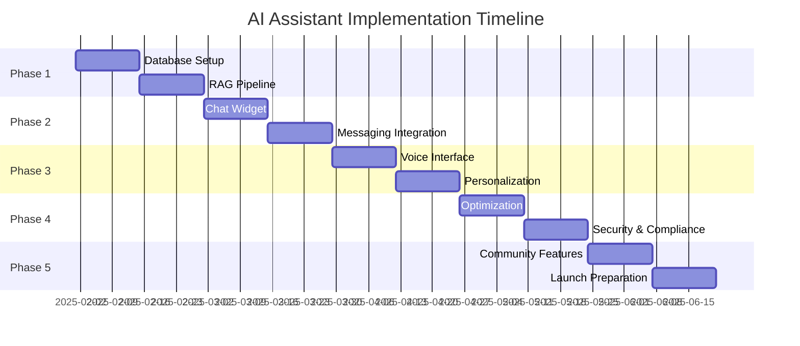

# AI Assistant Implementation Roadmap

## Overview
This roadmap details the phased implementation of an AI assistant for the Nelson Tech community platform, with timelines, milestones, resource requirements, and success metrics.

## Implementation Phases

### 🎯 Phase 1: Foundation & Infrastructure (Weeks 1-4)

#### Week 1-2: Database & Embedding Setup
**Objectives:**
- Enable pgvector extension in Supabase
- Create embedding tables and indexes
- Set up content ingestion pipeline

**Tasks:**
1. **Database Setup**
   - Enable pgvector extension
   - Create `content_embeddings` table
   - Create `ai_conversations` table
   - Create `ai_audit_logs` table
   - Set up HNSW indexes

2. **Embedding Service**
   - Implement embedding generation service
   - Set up OpenAI/Sentence Transformer integration
   - Create content chunking strategies
   - Build incremental update system

3. **Initial Content Processing**
   - Process existing events data
   - Process news and resources
   - Generate embeddings for user profiles
   - Index company and group data

**Deliverables:**
- Functional vector search capability
- Embedded content database
- Basic search API endpoints

**Success Metrics:**
- 95% of content successfully embedded
- < 500ms average search response time
- Zero data loss during migration

#### Week 3-4: RAG Pipeline & Basic AI Integration
**Objectives:**
- Implement Retrieval-Augmented Generation
- Create AI conversation management
- Build permission filtering system

**Tasks:**
1. **RAG Implementation**
   - Build hybrid search function
   - Implement context retrieval
   - Create prompt templates
   - Set up response generation

2. **AI Service Layer**
   - Create AI conversation API
   - Implement context management
   - Build rate limiting system
   - Add audit logging

3. **Security Framework**
   - Implement prompt injection prevention
   - Create permission-aware filtering
   - Set up API key management
   - Build consent management system

**Deliverables:**
- Working RAG pipeline
- AI conversation API
- Security and permission system

**Success Metrics:**
- < 2s average response time
- 99% uptime for AI service
- Zero security vulnerabilities

### 🚀 Phase 2: User Interface & Integration (Weeks 5-8)

#### Week 5-6: Chat Widget & UI Components
**Objectives:**
- Build AI chat interface
- Create contextual help system
- Implement suggestion engine

**Tasks:**
1. **Chat Widget Development**
   ```typescript
   // Component structure
   - ChatWidget.tsx (main container)
   - MessageList.tsx (conversation display)
   - InputArea.tsx (user input handling)
   - SuggestionBar.tsx (quick actions)
   - VoiceButton.tsx (voice input)
   ```

2. **UI/UX Implementation**
   - Responsive chat widget design
   - Typing indicators and loading states
   - Error handling and fallbacks
   - Mobile-optimized interface

3. **Contextual Integration**
   - Page-aware assistance
   - Form field suggestions
   - Smart tooltips
   - Inline help system

**Deliverables:**
- Fully functional chat widget
- Contextual help components
- Mobile-responsive design

**Success Metrics:**
- < 100ms UI response time
- 90% user satisfaction score
- Accessibility score > 95

#### Week 7-8: Messaging System Integration
**Objectives:**
- Extend messaging system for AI
- Implement real-time responses
- Create conversation persistence

**Tasks:**
1. **Messaging API Extension**
   - Add AI participant type
   - Implement streaming responses
   - Create conversation threading
   - Build message formatting

2. **Real-time Features**
   - WebSocket integration
   - Live typing indicators
   - Response streaming
   - Presence awareness

3. **Conversation Management**
   - Session persistence
   - History retrieval
   - Context switching
   - Multi-tab synchronization

**Deliverables:**
- AI-integrated messaging system
- Real-time response streaming
- Conversation history management

**Success Metrics:**
- < 100ms message latency
- 99.9% message delivery rate
- Seamless context preservation

### 🎨 Phase 3: Enhanced Features (Weeks 9-12)

#### Week 9-10: Voice Interface & Accessibility
**Objectives:**
- Implement voice interaction
- Ensure full accessibility
- Add multi-modal support

**Tasks:**
1. **Voice Processing**
   - Web Speech API integration
   - Whisper API fallback
   - Real-time transcription
   - Text-to-speech output

2. **Accessibility Features**
   - Screen reader support
   - Keyboard navigation
   - High contrast mode
   - Alternative input methods

3. **Multi-modal Support**
   - Voice + text combination
   - Visual feedback system
   - Gesture controls
   - Haptic feedback (mobile)

**Deliverables:**
- Voice-enabled assistant
- WCAG AAA compliance
- Multi-modal interface

**Success Metrics:**
- < 2s voice processing time
- 95% transcription accuracy
- 100% accessibility compliance

#### Week 11-12: Personalization & Intelligence
**Objectives:**
- Implement user personalization
- Add proactive assistance
- Create recommendation engine

**Tasks:**
1. **Personalization Engine**
   - User preference learning
   - Behavior pattern analysis
   - Custom response tuning
   - Interest-based filtering

2. **Proactive Features**
   - Smart notifications
   - Contextual suggestions
   - Task automation
   - Predictive assistance

3. **Recommendation System**
   - Content recommendations
   - Connection suggestions
   - Event discovery
   - Learning paths

**Deliverables:**
- Personalized AI responses
- Proactive assistance features
- Recommendation engine

**Success Metrics:**
- 80% recommendation relevance
- 30% increase in user engagement
- 25% reduction in support tickets

### 🔧 Phase 4: Optimization & Scale (Weeks 13-16)

#### Week 13-14: Performance Optimization
**Objectives:**
- Optimize response times
- Implement caching strategies
- Reduce operational costs

**Tasks:**
1. **Caching Implementation**
   - Response caching layer
   - Embedding cache
   - Context caching
   - CDN integration

2. **Query Optimization**
   - Database query tuning
   - Index optimization
   - Batch processing
   - Connection pooling

3. **Cost Optimization**
   - Token usage reduction
   - Efficient embedding strategies
   - API call minimization
   - Resource allocation

**Deliverables:**
- Optimized AI pipeline
- Caching infrastructure
- Cost reduction strategy

**Success Metrics:**
- 50% reduction in response time
- 40% reduction in API costs
- 99.99% availability

#### Week 15-16: Security Hardening & Compliance
**Objectives:**
- Complete security audit
- Ensure GDPR compliance
- Implement monitoring

**Tasks:**
1. **Security Hardening**
   - Penetration testing
   - Vulnerability assessment
   - Security patch implementation
   - Access control review

2. **Compliance Implementation**
   - GDPR compliance audit
   - Data retention policies
   - User consent workflows
   - Privacy documentation

3. **Monitoring Setup**
   - Performance monitoring
   - Error tracking
   - Usage analytics
   - Anomaly detection

**Deliverables:**
- Security audit report
- Compliance documentation
- Monitoring dashboard

**Success Metrics:**
- Zero critical vulnerabilities
- 100% GDPR compliance
- < 1% error rate

### 🚀 Phase 5: Advanced Capabilities (Weeks 17-20)

#### Week 17-18: Community AI Features
**Objectives:**
- Enable community-wide AI features
- Implement collaborative AI
- Create AI-powered workflows

**Tasks:**
1. **Community Features**
   - Group AI assistants
   - Collaborative knowledge base
   - Community insights
   - Trend analysis

2. **Workflow Automation**
   - Event creation assistance
   - Content generation
   - Automated moderation
   - Smart scheduling

3. **Analytics Dashboard**
   - AI usage metrics
   - Community insights
   - Performance analytics
   - ROI tracking

**Deliverables:**
- Community AI features
- Automated workflows
- Analytics dashboard

**Success Metrics:**
- 50% automation of routine tasks
- 60% increase in content quality
- 40% reduction in moderation time

#### Week 19-20: Launch Preparation
**Objectives:**
- Final testing and QA
- Documentation completion
- Training and rollout

**Tasks:**
1. **Quality Assurance**
   - End-to-end testing
   - Load testing
   - User acceptance testing
   - Bug fixing

2. **Documentation**
   - User documentation
   - API documentation
   - Admin guides
   - Training materials

3. **Launch Activities**
   - Soft launch to beta users
   - Feedback collection
   - Performance monitoring
   - Gradual rollout

**Deliverables:**
- Production-ready AI assistant
- Complete documentation
- Training program

**Success Metrics:**
- 95% test coverage
- < 5 critical bugs
- 90% user adoption rate

## Resource Requirements

### Team Composition
```
┌─────────────────────────────────────────┐
│ Core Development Team                    │
├─────────────────────────────────────────┤
│ • 1x AI/ML Engineer (Lead)              │
│ • 2x Full-Stack Developers              │
│ • 1x UI/UX Designer                     │
│ • 1x DevOps Engineer                    │
│ • 1x QA Engineer                        │
└─────────────────────────────────────────┘

┌─────────────────────────────────────────┐
│ Support Team                             │
├─────────────────────────────────────────┤
│ • 1x Project Manager                    │
│ • 1x Security Specialist (Part-time)    │
│ • 1x Data Scientist (Part-time)         │
│ • 1x Technical Writer (Part-time)       │
└─────────────────────────────────────────┘
```

### Infrastructure Costs (Monthly)
```
┌─────────────────────────────────────────┐
│ Service              │ Cost Estimate     │
├──────────────────────┼──────────────────┤
│ OpenAI API          │ $2,000 - $5,000   │
│ Supabase (Upgraded) │ $500 - $1,000     │
│ CDN/Caching         │ $200 - $500       │
│ Monitoring          │ $100 - $300       │
│ Voice Services      │ $300 - $800       │
├──────────────────────┼──────────────────┤
│ Total               │ $3,100 - $7,600   │
└─────────────────────────────────────────┘
```

### Development Tools & Services
- GitHub Enterprise: $21/user/month
- Monitoring (Datadog/New Relic): $500/month
- Testing Infrastructure: $300/month
- Documentation Platform: $100/month

## Risk Mitigation

### Technical Risks
| Risk | Probability | Impact | Mitigation |
|------|------------|--------|------------|
| API Rate Limits | Medium | High | Implement caching, queuing, fallback providers |
| Data Privacy Breach | Low | Critical | Encryption, access controls, audit logging |
| Performance Issues | Medium | Medium | Load testing, auto-scaling, optimization |
| Integration Complexity | High | Medium | Phased rollout, extensive testing |

### Business Risks
| Risk | Probability | Impact | Mitigation |
|------|------------|--------|------------|
| User Adoption | Medium | High | User training, gradual rollout, feedback loops |
| Cost Overrun | Medium | Medium | Usage monitoring, cost alerts, optimization |
| Compliance Issues | Low | High | Legal review, privacy assessment, documentation |

## Success Metrics & KPIs

### User Engagement
- **Daily Active Users**: Target 60% of total users
- **Average Sessions per User**: > 3 per week
- **Query Volume**: > 1000 queries/day by month 3
- **User Satisfaction**: > 4.5/5 rating

### Technical Performance
- **Response Time**: < 2 seconds (p95)
- **Accuracy**: > 85% relevant responses
- **Uptime**: 99.9% availability
- **Error Rate**: < 1% of requests

### Business Impact
- **Support Ticket Reduction**: 40% decrease
- **User Retention**: 20% improvement
- **Content Engagement**: 35% increase
- **Community Activity**: 25% growth

### Cost Efficiency
- **Cost per Query**: < $0.05
- **Infrastructure Utilization**: > 70%
- **API Efficiency**: < 1000 tokens/query average
- **Cache Hit Rate**: > 60%

## Milestone Schedule



## Communication Plan

### Stakeholder Updates
- **Weekly**: Development team standup
- **Bi-weekly**: Stakeholder progress reports
- **Monthly**: Executive briefing
- **Quarterly**: Board presentation

### User Communication
- **Pre-launch**: Feature announcements, beta invitations
- **Launch**: Release notes, training webinars
- **Post-launch**: Feedback surveys, improvement updates

## Post-Launch Support

### Month 1-3: Stabilization
- Bug fixes and performance tuning
- User feedback integration
- Feature refinement
- Documentation updates

### Month 4-6: Enhancement
- Advanced feature rollout
- Integration expansions
- Performance optimization
- Scale testing

### Ongoing: Maintenance
- Regular updates and patches
- Model retraining
- Content re-indexing
- Security updates

## Conclusion

This roadmap provides a structured approach to implementing a sophisticated AI assistant for the Nelson Tech community platform. The phased approach ensures manageable development cycles while delivering incremental value. Success depends on strong technical execution, user-centered design, and continuous optimization based on feedback and metrics.