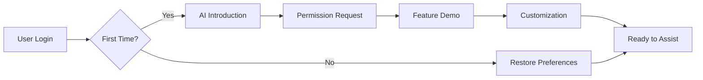

# AI Assistant UI/UX Design Specification

## 1. Design Philosophy

### Core Principles
- **Ambient Intelligence**: AI assistance should feel natural and unobtrusive
- **Progressive Disclosure**: Complexity revealed only when needed
- **Context Awareness**: Interface adapts to user's current task
- **Accessibility First**: WCAG AAA compliance with multimodal interaction
- **Trust Through Transparency**: Clear AI identification and capabilities

## 2. Interface Components

### 2.1 Primary Chat Widget

#### Visual Design
```
┌─────────────────────────────────────┐
│  Nelson AI Assistant           ⚡ 🔊 ✕ │
├─────────────────────────────────────┤
│                                      │
│  👤 How can I find upcoming events? │
│                                      │
│  🤖 I can help you discover events! │
│     Here are today's highlights:    │
│                                      │
│     📅 Tech Meetup - 6:00 PM       │
│     📅 Workshop: AI Basics - 7:30 PM│
│                                      │
│     Would you like to see more or   │
│     filter by category?             │
│                                      │
├─────────────────────────────────────┤
│  💬 Type a message...          🎤 📎 │
├─────────────────────────────────────┤
│  Suggested: "Show workshops"  "Today"│
└─────────────────────────────────────┘
```

#### Component Specifications
```typescript
interface ChatWidgetProps {
  // Positioning
  position: 'bottom-right' | 'bottom-left' | 'sidebar' | 'fullscreen';
  initialState: 'minimized' | 'expanded' | 'hidden';
  
  // Appearance
  theme: 'light' | 'dark' | 'auto' | 'high-contrast';
  size: 'compact' | 'standard' | 'large';
  transparency: number; // 0-1
  
  // Features
  features: {
    voice: boolean;
    attachments: boolean;
    suggestions: boolean;
    history: boolean;
    reactions: boolean;
    translation: boolean;
  };
  
  // Behavior
  behavior: {
    autoExpand: boolean;
    persistState: boolean;
    keyboardShortcut: string; // e.g., 'cmd+k'
    idleTimeout: number; // milliseconds
  };
}
```

### 2.2 Contextual Help Overlays

#### Inline Assistance Pattern
```
┌──────────────────────────────────┐
│  Create New Event                 │
│                                   │
│  Event Title: [________________] │
│              ┌──────────────────┐│
│              │ 💡 AI Suggestion  ││
│              │ Based on similar  ││
│              │ events: "Tech Talk││
│              │ Tuesday: AI & You"││
│              └──────────────────┘│
│  Date: [___________]              │
│                                   │
└──────────────────────────────────┘
```

#### Smart Tooltips
```typescript
interface SmartTooltip {
  trigger: 'hover' | 'focus' | 'click' | 'auto';
  content: {
    text: string;
    suggestions?: string[];
    examples?: string[];
    learnMore?: string;
  };
  position: 'top' | 'bottom' | 'left' | 'right' | 'auto';
  delay: number;
  persistence: 'temporary' | 'sticky' | 'dismissible';
}
```

### 2.3 Voice Interface Design

#### Visual Feedback States
```
Idle:        ○
Listening:   ◐ ◓ ◑ ◒ (animated)
Processing:  ⟳ (rotating)
Speaking:    ♪ ♫ ♪ (animated)
Error:       ⚠
```

#### Voice UI Component
```typescript
interface VoiceInterface {
  // Visual elements
  visualizer: {
    type: 'waveform' | 'rings' | 'dots' | 'minimal';
    color: string;
    sensitivity: number;
  };
  
  // Interaction modes
  activation: {
    method: 'push-to-talk' | 'toggle' | 'wake-word';
    hotkey?: string;
    wakeWord?: string;
  };
  
  // Feedback
  feedback: {
    haptic: boolean;
    audio: boolean;
    visual: boolean;
    transcription: boolean;
  };
}
```

### 2.4 Proactive Assistance Notifications

#### Notification Patterns
```
┌─────────────────────────────────┐
│ 🤖 AI Assistant                 │
│                                  │
│ I noticed you're creating an    │
│ event similar to last month's.  │
│ Would you like me to:           │
│                                  │
│ [Copy Settings] [Start Fresh]   │
└─────────────────────────────────┘
```

## 3. User Interaction Flows

### 3.1 Onboarding Flow



#### Onboarding Screens

**Screen 1: Introduction**
```
Welcome to Your AI Assistant! 👋

I'm here to help you:
• Find relevant content quickly
• Connect with community members
• Manage events and activities
• Answer questions about the platform

[Get Started] [Skip]
```

**Screen 2: Permissions**
```
To provide the best assistance, I need your permission for:

☑ Personalized recommendations
☑ Learning from your interactions
☐ Voice interaction (optional)
☐ Proactive suggestions (optional)

[Customize] [Accept All] [Essential Only]
```

**Screen 3: Customization**
```
How would you like me to assist you?

Interaction Style:
○ Professional  ● Friendly  ○ Minimal

Proactivity Level:
[────●────────] Medium

Preferred Features:
☑ Quick suggestions
☑ Keyboard shortcuts
☐ Voice commands
☑ Auto-complete

[Save Preferences]
```

### 3.2 Context-Aware Assistance Flow

```typescript
interface ContextualAssistance {
  // Page context detection
  detectContext(): PageContext;
  
  // Contextual help provision
  provideHelp(context: PageContext): AssistanceOptions;
  
  // User action prediction
  predictNextAction(context: PageContext, history: UserAction[]): Suggestion[];
}

enum PageContext {
  EVENT_CREATION = 'event_creation',
  MESSAGE_THREAD = 'message_thread',
  PROFILE_EDITING = 'profile_editing',
  CONTENT_BROWSING = 'content_browsing',
  DASHBOARD = 'dashboard',
  SEARCH_RESULTS = 'search_results'
}
```

### 3.3 Error Recovery Flow

```
User Input → Processing → Error Detection
                ↓
        ┌──────────────┐
        │ Error Handler │
        └──────┬───────┘
               ↓
    ┌──────────────────────┐
    │ Graceful Degradation │
    └──────────────────────┘
               ↓
         Three Options:
    1. Retry with modification
    2. Fallback to simpler query
    3. Escalate to human help
```

## 4. Mobile Experience

### 4.1 Mobile-First Design

#### Compact Chat Interface
```
┌─────────────────┐
│ 🤖 Nelson AI    │
├─────────────────┤
│ How can I help? │
│                 │
│ [Event] [People]│
│ [News] [Help]   │
├─────────────────┤
│ 💬 Ask anything │
└─────────────────┘
```

#### Gesture Controls
- **Swipe Up**: Expand chat
- **Swipe Down**: Minimize
- **Swipe Left/Right**: Navigate suggestions
- **Long Press**: Voice input
- **Double Tap**: Quick actions

### 4.2 Responsive Breakpoints

```scss
// Breakpoint definitions
$mobile-small: 320px;
$mobile: 375px;
$tablet: 768px;
$desktop: 1024px;
$desktop-large: 1440px;

// Chat widget responsive sizing
.ai-chat-widget {
  // Mobile
  @media (max-width: $tablet) {
    width: 100%;
    height: 60vh;
    border-radius: 20px 20px 0 0;
  }
  
  // Tablet
  @media (min-width: $tablet) and (max-width: $desktop) {
    width: 400px;
    height: 500px;
    border-radius: 12px;
  }
  
  // Desktop
  @media (min-width: $desktop) {
    width: 450px;
    height: 600px;
    border-radius: 16px;
  }
}
```

## 5. Accessibility Features

### 5.1 Screen Reader Support

```html
<!-- Accessible chat widget structure -->
<div role="complementary" aria-label="AI Assistant">
  <div role="log" aria-live="polite" aria-label="Chat messages">
    <div role="article" aria-label="AI message">
      <span class="sr-only">AI Assistant says:</span>
      <p>How can I help you today?</p>
    </div>
  </div>
  
  <form role="form" aria-label="Send message">
    <label for="ai-input" class="sr-only">Type your message</label>
    <input 
      id="ai-input"
      type="text"
      aria-describedby="ai-suggestions"
      aria-autocomplete="list"
    />
    <div id="ai-suggestions" role="status" aria-live="polite">
      <!-- Dynamic suggestions -->
    </div>
  </form>
</div>
```

### 5.2 Keyboard Navigation

```typescript
interface KeyboardShortcuts {
  globalToggle: 'Cmd+K' | 'Ctrl+K';
  
  chatNavigation: {
    nextMessage: 'ArrowDown';
    previousMessage: 'ArrowUp';
    focusInput: '/';
    selectSuggestion: 'Tab';
    dismissChat: 'Escape';
  };
  
  voiceControl: {
    startListening: 'Cmd+Shift+V';
    stopListening: 'Escape';
  };
  
  quickActions: {
    help: 'Cmd+H';
    search: 'Cmd+F';
    newEvent: 'Cmd+N';
  };
}
```

### 5.3 Visual Accessibility

```typescript
interface AccessibilitySettings {
  // Visual
  highContrast: boolean;
  fontSize: 'small' | 'medium' | 'large' | 'extra-large';
  reducedMotion: boolean;
  colorBlindMode: 'none' | 'protanopia' | 'deuteranopia' | 'tritanopia';
  
  // Audio
  screenReaderMode: boolean;
  audioDescriptions: boolean;
  soundEffects: boolean;
  
  // Interaction
  keyboardOnly: boolean;
  voiceControl: boolean;
  dwellClicking: boolean;
  stickyKeys: boolean;
}
```

## 6. Animation & Transitions

### 6.1 Micro-interactions

```css
/* Typing indicator animation */
@keyframes typing {
  0%, 60%, 100% { opacity: 0.3; }
  30% { opacity: 1; }
}

.typing-indicator span {
  animation: typing 1.4s infinite;
}
.typing-indicator span:nth-child(2) {
  animation-delay: 0.2s;
}
.typing-indicator span:nth-child(3) {
  animation-delay: 0.4s;
}

/* Message appearance */
.message-appear {
  animation: slideUp 0.3s ease-out;
}

@keyframes slideUp {
  from {
    opacity: 0;
    transform: translateY(20px);
  }
  to {
    opacity: 1;
    transform: translateY(0);
  }
}

/* Respect reduced motion preference */
@media (prefers-reduced-motion: reduce) {
  * {
    animation-duration: 0.01ms !important;
    transition-duration: 0.01ms !important;
  }
}
```

### 6.2 Loading States

```typescript
interface LoadingStates {
  initial: 'shimmer' | 'skeleton' | 'spinner';
  streaming: 'progressive' | 'word-by-word' | 'instant';
  error: 'shake' | 'pulse' | 'static';
  success: 'checkmark' | 'fade' | 'none';
}

// Progressive text streaming
class TextStreamer {
  async streamResponse(text: string, speed: number = 30) {
    const words = text.split(' ');
    let displayed = '';
    
    for (const word of words) {
      displayed += word + ' ';
      await this.updateDisplay(displayed);
      await this.delay(speed);
    }
  }
}
```

## 7. Theme System

### 7.1 Design Tokens

```typescript
interface DesignTokens {
  colors: {
    // Primary palette
    primary: string;
    primaryLight: string;
    primaryDark: string;
    
    // AI-specific colors
    aiAccent: string;
    aiBackground: string;
    aiBorder: string;
    
    // Semantic colors
    success: string;
    warning: string;
    error: string;
    info: string;
  };
  
  typography: {
    fontFamily: string;
    fontSize: {
      xs: string;
      sm: string;
      md: string;
      lg: string;
      xl: string;
    };
    fontWeight: {
      light: number;
      regular: number;
      medium: number;
      bold: number;
    };
  };
  
  spacing: {
    xs: string;
    sm: string;
    md: string;
    lg: string;
    xl: string;
  };
  
  borderRadius: {
    sm: string;
    md: string;
    lg: string;
    full: string;
  };
  
  shadows: {
    sm: string;
    md: string;
    lg: string;
    xl: string;
  };
}
```

### 7.2 Theme Variants

```scss
// Light theme
.theme-light {
  --ai-bg: #ffffff;
  --ai-text: #1a1a1a;
  --ai-accent: #4f46e5;
  --ai-border: #e5e7eb;
  --ai-message-user: #f3f4f6;
  --ai-message-ai: #ede9fe;
}

// Dark theme
.theme-dark {
  --ai-bg: #1f2937;
  --ai-text: #f9fafb;
  --ai-accent: #818cf8;
  --ai-border: #374151;
  --ai-message-user: #374151;
  --ai-message-ai: #312e81;
}

// High contrast theme
.theme-high-contrast {
  --ai-bg: #000000;
  --ai-text: #ffffff;
  --ai-accent: #ffff00;
  --ai-border: #ffffff;
  --ai-message-user: #ffffff;
  --ai-message-ai: #ffff00;
}
```

## 8. Component Library

### 8.1 Core Components

```typescript
// Message component
interface MessageProps {
  content: string;
  sender: 'user' | 'ai' | 'system';
  timestamp: Date;
  status: 'sending' | 'sent' | 'error';
  actions?: MessageAction[];
  attachments?: Attachment[];
}

// Suggestion chip
interface SuggestionChipProps {
  text: string;
  icon?: string;
  onClick: () => void;
  variant: 'primary' | 'secondary' | 'outline';
}

// Voice visualizer
interface VoiceVisualizerProps {
  isActive: boolean;
  amplitude: number;
  frequency: number[];
  style: 'waveform' | 'bars' | 'circle';
}

// Quick action button
interface QuickActionProps {
  label: string;
  icon: string;
  action: () => void;
  badge?: number;
  disabled?: boolean;
}
```

### 8.2 Composite Components

```tsx
// AI Assistant Container
const AIAssistantContainer: React.FC = () => {
  return (
    <div className="ai-assistant-container">
      <Header />
      <MessageList />
      <TypingIndicator />
      <SuggestionBar />
      <InputArea />
      <QuickActions />
    </div>
  );
};

// Contextual Help Overlay
const ContextualHelp: React.FC<ContextualHelpProps> = ({
  context,
  position,
  suggestions
}) => {
  return (
    <div className="contextual-help" style={{ position }}>
      <div className="help-content">
        <p>{context.helpText}</p>
        {suggestions.map(s => (
          <SuggestionChip key={s.id} {...s} />
        ))}
      </div>
    </div>
  );
};
```

## 9. User Preferences

### 9.1 Customization Options

```typescript
interface UserPreferences {
  // Appearance
  appearance: {
    theme: 'light' | 'dark' | 'auto';
    compactMode: boolean;
    fontSize: number;
    chatPosition: string;
  };
  
  // Behavior
  behavior: {
    autoSuggest: boolean;
    soundEffects: boolean;
    notifications: boolean;
    proactiveHelp: boolean;
    responseSpeed: 'instant' | 'natural' | 'slow';
  };
  
  // Privacy
  privacy: {
    saveHistory: boolean;
    shareAnalytics: boolean;
    personalizedSuggestions: boolean;
    dataRetention: number; // days
  };
  
  // Accessibility
  accessibility: {
    screenReader: boolean;
    keyboardShortcuts: boolean;
    voiceControl: boolean;
    highContrast: boolean;
  };
}
```

### 9.2 Settings UI

```
┌────────────────────────────────┐
│ AI Assistant Settings          │
├────────────────────────────────┤
│ Appearance                     │
│ Theme:        [Auto ▼]         │
│ Position:     [Bottom Right ▼] │
│ ☑ Compact mode                 │
│                                │
│ Behavior                       │
│ ☑ Show suggestions             │
│ ☑ Enable notifications         │
│ ☐ Proactive assistance         │
│                                │
│ Privacy                        │
│ ☑ Save conversation history    │
│ ☐ Share usage analytics        │
│ History: [30 days ▼]           │
│                                │
│ [Save] [Reset] [Cancel]        │
└────────────────────────────────┘
```

## 10. Metrics & Analytics

### 10.1 UX Metrics

```typescript
interface UXMetrics {
  // Engagement metrics
  engagement: {
    dailyActiveUsers: number;
    averageSessionDuration: number;
    messagesPerSession: number;
    featureAdoption: Record<string, number>;
  };
  
  // Usability metrics
  usability: {
    taskCompletionRate: number;
    errorRate: number;
    timeToFirstInteraction: number;
    abandonmentRate: number;
  };
  
  // Satisfaction metrics
  satisfaction: {
    npsScore: number;
    csatScore: number;
    feedbackSentiment: number;
    featureRatings: Record<string, number>;
  };
  
  // Accessibility metrics
  accessibility: {
    screenReaderUsage: number;
    keyboardNavigationUsage: number;
    voiceControlUsage: number;
    highContrastUsage: number;
  };
}
```

### 10.2 A/B Testing Framework

```typescript
interface ABTest {
  name: string;
  variants: {
    control: ComponentVariant;
    treatment: ComponentVariant;
  };
  metrics: string[];
  allocation: number; // percentage
  duration: number; // days
}

// Example A/B tests
const tests: ABTest[] = [
  {
    name: 'chat_widget_position',
    variants: {
      control: { position: 'bottom-right' },
      treatment: { position: 'sidebar' }
    },
    metrics: ['engagement', 'task_completion'],
    allocation: 50,
    duration: 14
  },
  {
    name: 'proactive_suggestions',
    variants: {
      control: { enabled: false },
      treatment: { enabled: true }
    },
    metrics: ['satisfaction', 'efficiency'],
    allocation: 30,
    duration: 30
  }
];
```

## Implementation Guidelines

### Development Workflow
1. Create design mockups in Figma
2. Build component library in Storybook
3. Implement with React + TypeScript
4. Test accessibility with axe-core
5. Conduct usability testing
6. Iterate based on feedback

### Performance Targets
- First paint: < 1s
- Interactive: < 2s
- Response time: < 100ms
- Animation: 60 fps
- Bundle size: < 100KB

### Browser Support
- Chrome 90+
- Safari 14+
- Firefox 88+
- Edge 90+
- Mobile Safari 14+
- Chrome Mobile 90+

This comprehensive UI/UX specification provides detailed design guidelines for creating an intuitive, accessible, and engaging AI assistant interface that seamlessly integrates with the Nelson Tech community platform.