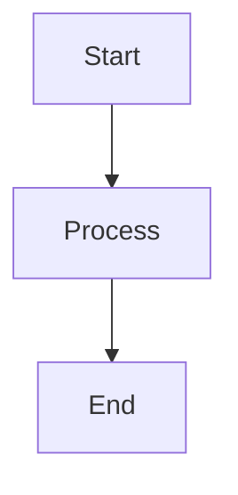

# MkDocs Documentation Site Setup

This documentation is built using [MkDocs](https://www.mkdocs.org/) with the [Material for MkDocs](https://squidfunk.github.io/mkdocs-material/) theme.

## Features

Our documentation site includes:

- **Material Design** - Modern, responsive theme
- **Search** - Full-text search across all documentation
- **Dark/Light Mode** - Automatic theme switching
- **Navigation** - Multi-level navigation with tabs
- **Code Highlighting** - Syntax highlighting for all languages
- **Admonitions** - Notes, tips, warnings, and more
- **Mermaid Diagrams** - Flowcharts and diagrams
- **Git Integration** - Last updated dates from git history
- **Mobile Responsive** - Optimized for all devices

## Local Development

### Prerequisites

- Python 3.8 or higher
- pip (Python package manager)

### Installation

1. Install MkDocs and dependencies:

```bash
pip install -r requirements-docs.txt
```

### Running Locally

Start the development server:

```bash
mkdocs serve
```

The documentation will be available at `http://127.0.0.1:8000`

The dev server will auto-reload when you save changes to documentation files.

### Building

Build the static site:

```bash
mkdocs build
```

This creates a `site/` directory with the static HTML files.

### Preview Build

Preview the built site:

```bash
mkdocs serve --dirtyreload
```

## Deployment

### GitHub Pages (Automatic)

The documentation is automatically deployed to GitHub Pages when changes are pushed to the `main` branch.

**Workflow:** `.github/workflows/docs.yml`

**Triggers:**
- Push to `main` branch with changes to `docs/**`, `mkdocs.yml`, or workflow file
- Manual workflow dispatch

**URL:** `https://iaminawe.github.io/nelson-tech/`

### Manual Deployment

Deploy manually to GitHub Pages:

```bash
mkdocs gh-deploy
```

This builds the site and pushes to the `gh-pages` branch.

## Configuration

### Main Configuration

**File:** `mkdocs.yml`

Key sections:
- `site_name`, `site_description` - Site metadata
- `theme` - Material theme configuration
- `nav` - Navigation structure
- `plugins` - Enabled plugins
- `markdown_extensions` - Markdown features

### Custom Styling

**File:** `docs/stylesheets/extra.css`

Custom CSS for:
- Brand colors (orange theme)
- Card grids
- Code blocks
- Tables
- Badges
- Hero sections

### Navigation Structure

The navigation in `mkdocs.yml` is organized into major sections:

1. **Getting Started** - Quick start, setup, contributing
2. **Architecture** - System design and patterns
3. **Development Guides** - Implementation guides
4. **Features** - Feature-specific documentation
5. **Components** - UI component library
6. **Patterns & Templates** - Code templates
7. **Deployment** - Production deployment
8. **Design & Theming** - Visual design system
9. **Business & Strategy** - AI and SaaS planning
10. **Implementation** - Implementation reports
11. **Migrations** - Migration guides
12. **Testing & QA** - QA and testing docs
13. **Reference** - General reference materials

## Writing Documentation

### Markdown Features

MkDocs supports extended Markdown with many features:

#### Admonitions

```markdown
!!! note "Optional Title"
    This is a note admonition.

!!! tip
    This is a tip.

!!! warning
    This is a warning.

!!! danger
    This is a danger/error message.
```

#### Code Blocks

````markdown
```python
def hello():
    print("Hello, World!")
```
````

#### Tabs

```markdown
=== "Tab 1"
    Content for tab 1

=== "Tab 2"
    Content for tab 2
```

#### Task Lists

```markdown
- [x] Completed task
- [ ] Incomplete task
```

#### Tables

```markdown
| Column 1 | Column 2 |
|----------|----------|
| Value 1  | Value 2  |
```

#### Mermaid Diagrams

````markdown

````

### Custom Components

#### Card Grid

```html
<div class="grid cards" markdown>

-   :material-rocket:{ .lg } __Title__

    ---

    Description

    [:octicons-arrow-right-24: Link](path.md)

</div>
```

#### Badges

```html
<span class="badge badge-new">NEW</span>
<span class="badge badge-important">IMPORTANT</span>
<span class="badge badge-deprecated">DEPRECATED</span>
```

### Icons

Use Material Design Icons:

```markdown
:material-rocket-launch: Rocket
:octicons-check-16: Check
:fontawesome-brands-github: GitHub
```

## File Organization

```
nelson-tech/
├── docs/                       # Documentation source
│   ├── index.md               # Landing page
│   ├── README.md              # Getting started
│   ├── architecture/          # Architecture docs
│   ├── features/              # Feature docs
│   │   ├── README.md         # Features overview
│   │   ├── gallery/
│   │   ├── groups/
│   │   └── ...
│   ├── guides/                # Development guides
│   ├── business/              # Business strategy
│   ├── stylesheets/           # Custom CSS
│   │   └── extra.css
│   └── ...
├── mkdocs.yml                 # MkDocs configuration
├── requirements-docs.txt      # Python dependencies
└── .github/
    └── workflows/
        └── docs.yml           # GitHub Actions workflow
```

## Best Practices

### Documentation Structure

1. **One Topic Per Page** - Keep pages focused
2. **Clear Headings** - Use descriptive section headers
3. **Cross-Linking** - Link related documentation
4. **Code Examples** - Include practical examples
5. **Keep Updated** - Update docs with code changes

### Markdown Style

1. **ATX Headings** - Use `#` style headings
2. **Fenced Code Blocks** - Use ``` for code
3. **Reference Links** - Use `[text][ref]` for repeated links
4. **Blank Lines** - Add blank lines between blocks
5. **Line Length** - Wrap at 120 characters (not enforced)

### Navigation

1. **Logical Grouping** - Group related docs
2. **Clear Labels** - Use descriptive navigation labels
3. **Consistent Depth** - Keep similar depth levels
4. **Overview Pages** - Add README.md to folders

## Troubleshooting

### Build Errors

**Error:** `Config file 'mkdocs.yml' does not exist`
- Ensure you're in the project root directory

**Error:** `No module named 'mkdocs'`
- Install dependencies: `pip install -r requirements-docs.txt`

**Error:** Navigation warnings
- Check that all files referenced in `nav` exist
- Verify file paths are correct (case-sensitive)

### Broken Links

Check for broken links:

```bash
mkdocs build --strict
```

This will fail on any warnings including broken links.

### Missing Files

If a page is missing from navigation:
1. Check the file exists in `docs/`
2. Verify it's listed in `mkdocs.yml` under `nav`
3. Check file path is correct

### Preview Not Updating

1. Stop the dev server (Ctrl+C)
2. Clear the cache: `rm -rf site/`
3. Restart: `mkdocs serve`

## Resources

- [MkDocs Documentation](https://www.mkdocs.org/)
- [Material for MkDocs](https://squidfunk.github.io/mkdocs-material/)
- [Markdown Guide](https://www.markdownguide.org/)
- [Material Icons](https://materialdesignicons.com/)
- [Mermaid Diagrams](https://mermaid-js.github.io/)

## Maintenance

### Updating Dependencies

Update MkDocs and plugins:

```bash
pip install --upgrade -r requirements-docs.txt
```

### Checking Site Health

1. **Build Test:**
   ```bash
   mkdocs build --strict --verbose
   ```

2. **Link Check:** Use `mkdocs-linkcheck` plugin (optional)

3. **Spelling:** Use a spell checker on markdown files

### Performance

The Material theme is optimized for performance:
- Static site generation
- Minified HTML/CSS/JS
- Instant loading with navigation prefetch
- Search index optimization

## Support

For issues with the documentation site:

1. Check this guide first
2. Review [MkDocs troubleshooting](https://www.mkdocs.org/#getting-help)
3. Check [Material theme docs](https://squidfunk.github.io/mkdocs-material/)
4. Open an issue on the repository

---

**Last Updated:** November 2025
