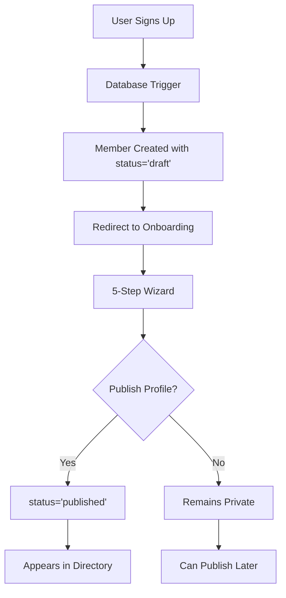

# Onboarding System Implementation Guide

## Overview

This guide documents the complete implementation of the Nelson Tech Community onboarding system, which provides a privacy-first approach to member registration with a comprehensive 5-step wizard.

## System Architecture

### Core Principles
1. **Privacy by Default**: New members start with `status='draft'`
2. **Progressive Disclosure**: 5-step wizard guides profile completion
3. **Optional Publishing**: Members choose when to appear in directory
4. **Seamless Integration**: Flows naturally from signup to community

### Data Flow


## Implementation Phases

### Phase 1: Core Infrastructure ✅
- Database schema with privacy controls
- Basic onboarding components
- Privacy hooks and utilities

### Phase 2: Integration & Routing 🚧
- Signup flow integration
- Onboarding route structure
- State management setup

### Phase 3: Wizard Implementation 📋
- 5-step wizard components
- Form validation and persistence
- Progress tracking

### Phase 4: Privacy & Publishing 🔒
- Directory privacy filtering
- Profile publishing workflow
- Privacy controls UI

## Component Structure

```
src/features/onboarding/
├── components/
│   ├── OnboardingWizard.tsx          # Main wizard container
│   ├── OnboardingLayout.tsx          # Layout with progress
│   ├── OnboardingGuard.tsx           # Route protection
│   ├── steps/
│   │   ├── WelcomeStep.tsx           # Introduction
│   │   ├── ProfessionalInfoStep.tsx  # Bio, skills, etc.
│   │   ├── CompanyAssociationStep.tsx # Company linking
│   │   ├── PrivacySettingsStep.tsx   # Privacy controls
│   │   └── CommunityEngagementStep.tsx # Groups & interests
│   └── shared/
│       ├── ProgressIndicator.tsx
│       ├── StepNavigation.tsx
│       └── ProfilePreview.tsx
├── hooks/
│   ├── useOnboarding.ts
│   ├── useOnboardingStep.ts
│   └── useProfilePublishing.ts
├── store/
│   └── onboardingSlice.ts
├── api/
│   └── onboardingApi.ts
├── types/
│   └── index.ts
└── utils/
    ├── validation.ts
    └── completion.ts
```

## Database Schema

### Members Table (Existing)
```sql
CREATE TABLE members (
    id UUID PRIMARY KEY,
    user_id UUID REFERENCES auth.users(id),
    name TEXT NOT NULL,
    title TEXT,
    bio TEXT,
    status TEXT DEFAULT 'draft', -- 'draft' | 'published' | 'suspended'
    -- ... other fields
);
```

### Onboarding Tracking (To Add)
```sql
ALTER TABLE members ADD COLUMN IF NOT EXISTS 
    onboarding_completed_at TIMESTAMP,
    onboarding_current_step INTEGER DEFAULT 1,
    onboarding_skipped_steps JSONB DEFAULT '[]',
    profile_completion_percentage INTEGER DEFAULT 0;
```

## API Endpoints

### Onboarding Progress
```typescript
// GET /api/onboarding/progress
{
  currentStep: number;
  completedSteps: number[];
  skippedSteps: number[];
  completionPercentage: number;
  isCompleted: boolean;
}

// POST /api/onboarding/progress
{
  step: number;
  action: 'complete' | 'skip' | 'navigate';
}
```

### Profile Publishing
```typescript
// POST /api/members/publish
{
  memberId: string;
  publish: boolean; // true = 'published', false = 'draft'
}

// GET /api/members/preview
{
  // Returns how profile will appear when published
}
```

## User Experience Flow

### New User Journey

#### 1. Sign Up (30 seconds)
```typescript
// SignUpForm.tsx
const handleSuccess = () => {
  // Redirect to onboarding instead of home
  navigate('/onboarding/welcome');
};
```

#### 2. Welcome Step
- Community introduction
- Value proposition
- Privacy assurance
- Expected time (5-10 minutes)

#### 3. Professional Information
- Name and title (pre-filled)
- Bio/description (rich text)
- Skills (multi-select + custom)
- Employment status
- Years of experience

#### 4. Company Association
- Search existing companies
- Join with verification
- Create new company
- Skip option available

#### 5. Privacy Settings
- Profile visibility control
- Contact information display
- Directory appearance
- Email notifications

#### 6. Community Engagement
- Interest areas
- Group recommendations
- Volunteering availability
- Mentorship preferences

#### 7. Completion & Publishing
- Profile preview
- Publish decision
- Success confirmation
- Next steps guidance

## Privacy System

### Status-Based Visibility
```typescript
// Member visibility states
type MemberStatus = 'draft' | 'published' | 'suspended';

// Directory query filtering
const getPublicMembers = async () => {
  return await supabase
    .from('members')
    .select('*')
    .eq('status', 'published')
    .order('created_at', { ascending: false });
};
```

### Privacy Controls
```typescript
interface PrivacySettings {
  profileVisibility: 'public' | 'members' | 'private';
  showEmail: boolean;
  showPhone: boolean;
  showLocation: boolean;
  allowMessages: boolean;
  allowConnectionRequests: boolean;
}
```

## State Management

### Redux Onboarding Slice
```typescript
interface OnboardingState {
  // Navigation
  currentStep: number;
  completedSteps: number[];
  skippedSteps: number[];
  
  // Form Data
  formData: {
    professional: ProfessionalInfo;
    company: CompanyAssociation;
    privacy: PrivacySettings;
    engagement: CommunityEngagement;
  };
  
  // Status
  isLoading: boolean;
  isSaving: boolean;
  errors: Record<string, string>;
  
  // Completion
  completionPercentage: number;
  isCompleted: boolean;
}
```

## Component Examples

### Onboarding Wizard Container
```typescript
const OnboardingWizard: React.FC = () => {
  const { currentStep, formData } = useOnboarding();
  const steps = ['Welcome', 'Professional', 'Company', 'Privacy', 'Community'];
  
  return (
    <OnboardingLayout>
      <ProgressIndicator 
        steps={steps} 
        currentStep={currentStep} 
      />
      
      <StepContent step={currentStep} />
      
      <StepNavigation 
        onNext={handleNext}
        onBack={handleBack}
        onSkip={handleSkip}
      />
    </OnboardingLayout>
  );
};
```

### Profile Publishing Component
```typescript
const ProfilePublisher: React.FC = () => {
  const [isPublishing, setIsPublishing] = useState(false);
  const { member } = useCurrentMember();
  
  const handlePublish = async () => {
    setIsPublishing(true);
    try {
      await publishProfile(member.id);
      toast.success('Your profile is now visible in the directory!');
    } catch (error) {
      toast.error('Failed to publish profile');
    } finally {
      setIsPublishing(false);
    }
  };
  
  return (
    <div className="space-y-4">
      <ProfilePreview member={member} />
      
      <Button
        onClick={handlePublish}
        loading={isPublishing}
        variant="primary"
      >
        Publish to Directory
      </Button>
    </div>
  );
};
```

## Testing Strategy

### Unit Tests
```typescript
describe('OnboardingWizard', () => {
  it('should start at welcome step', () => {
    const { getByText } = render(<OnboardingWizard />);
    expect(getByText('Welcome to Nelson Tech')).toBeInTheDocument();
  });
  
  it('should save progress on step completion', async () => {
    const { getByText } = render(<OnboardingWizard />);
    fireEvent.click(getByText('Next'));
    
    await waitFor(() => {
      expect(mockSaveProgress).toHaveBeenCalledWith({
        step: 2,
        action: 'complete'
      });
    });
  });
});
```

### Integration Tests
```typescript
describe('Onboarding Flow', () => {
  it('should redirect to onboarding after signup', async () => {
    // Sign up new user
    await signUp('test@example.com', 'password');
    
    // Should redirect to onboarding
    expect(window.location.pathname).toBe('/onboarding/welcome');
    
    // Member should be created with draft status
    const member = await getMember();
    expect(member.status).toBe('draft');
  });
});
```

## Error Handling

### Common Scenarios
1. **Network Failures**: Auto-save with retry
2. **Validation Errors**: Inline field validation
3. **Session Timeout**: Preserve form data
4. **Browser Crash**: Resume from last step

### Error Recovery
```typescript
const useOnboardingRecovery = () => {
  useEffect(() => {
    // Check for saved form data
    const savedData = localStorage.getItem('onboarding_data');
    if (savedData) {
      const shouldRestore = confirm('Resume your onboarding?');
      if (shouldRestore) {
        dispatch(restoreOnboarding(JSON.parse(savedData)));
      }
    }
  }, []);
};
```

## Performance Optimization

### Lazy Loading
```typescript
const OnboardingSteps = {
  welcome: lazy(() => import('./steps/WelcomeStep')),
  professional: lazy(() => import('./steps/ProfessionalInfoStep')),
  company: lazy(() => import('./steps/CompanyAssociationStep')),
  privacy: lazy(() => import('./steps/PrivacySettingsStep')),
  community: lazy(() => import('./steps/CommunityEngagementStep')),
};
```

### Auto-Save
```typescript
const useAutoSave = (formData: any) => {
  useDebounce(() => {
    localStorage.setItem('onboarding_data', JSON.stringify(formData));
  }, 1000, [formData]);
};
```

## Accessibility

### WCAG 2.1 AA Compliance
- Keyboard navigation support
- Screen reader announcements
- Focus management
- Error messaging
- Color contrast compliance

### Implementation
```typescript
const StepNavigation: React.FC = () => {
  return (
    <nav role="navigation" aria-label="Onboarding steps">
      <button
        aria-label="Go to previous step"
        disabled={currentStep === 1}
      >
        Back
      </button>
      
      <button
        aria-label="Continue to next step"
        aria-describedby="step-errors"
      >
        Next
      </button>
    </nav>
  );
};
```

## Monitoring & Analytics

### Key Metrics
```typescript
// Track onboarding events
analytics.track('onboarding_started', { userId });
analytics.track('onboarding_step_completed', { step, duration });
analytics.track('onboarding_completed', { totalDuration });
analytics.track('profile_published', { completionPercentage });
```

### Success Metrics
- Completion rate: >75% within 7 days
- Average time: <10 minutes
- Profile quality: >80% fields filled
- Publishing rate: >60% within 30 days

## Migration Guide

### For Existing Users
```sql
-- Set all existing members to published (opt-in approach)
UPDATE members 
SET status = 'published' 
WHERE status IS NULL;

-- Add onboarding fields with defaults
ALTER TABLE members 
ADD COLUMN onboarding_completed_at TIMESTAMP DEFAULT NOW(),
ADD COLUMN profile_completion_percentage INTEGER DEFAULT 100;
```

## Future Enhancements

### Phase 2 Features
- LinkedIn profile import
- AI-powered skill suggestions
- Video introductions
- Social login integration

### Phase 3 Features
- Personalized onboarding paths
- A/B testing framework
- Multi-language support
- API for third-party integrations

## Troubleshooting

### Common Issues

#### User stuck on step
```typescript
// Reset onboarding progress
await supabase
  .from('members')
  .update({ 
    onboarding_current_step: 1,
    onboarding_skipped_steps: []
  })
  .eq('id', memberId);
```

#### Profile not appearing in directory
```typescript
// Check member status
const { data: member } = await supabase
  .from('members')
  .select('status')
  .eq('id', memberId)
  .single();

// Status should be 'published'
```

## Support & Maintenance

### Regular Tasks
- Monitor completion rates
- Review error logs
- Update skill suggestions
- Refresh group recommendations

### Performance Monitoring
- Page load times
- Step transition speed
- API response times
- Error rates

This implementation guide provides a complete blueprint for building a robust, privacy-first onboarding system that respects user choices while encouraging community engagement.